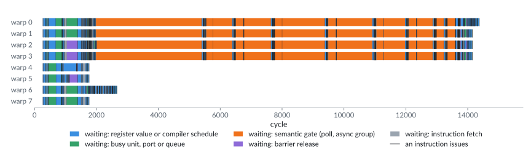
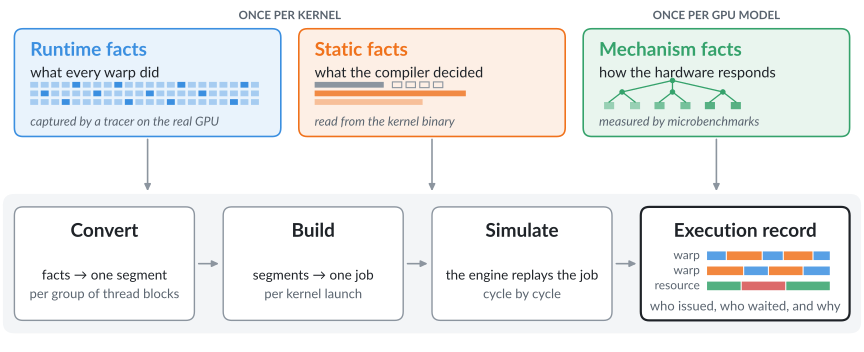
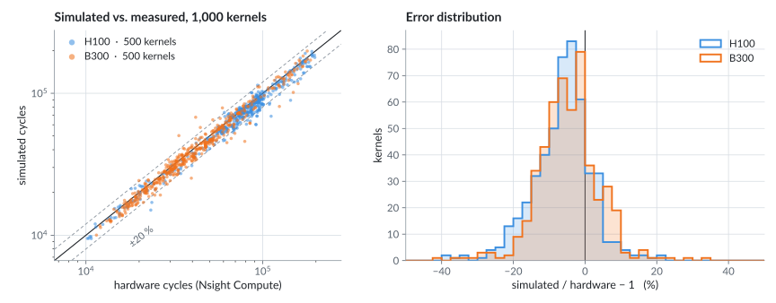

<p align="center">
  <picture>
    <source media="(prefers-color-scheme: dark)" srcset="docs/assets/logo-dark.svg">
    
  </picture>
</p>

<p align="center">
  <b>See what happened to your kernel on the GPU, cycle by cycle.</b>
</p>

<p align="center">
  <a href="LICENSE"></a>
  
  
  
</p>

<p align="center">
  <a href="#how-it-works">How it works</a> ·
  <a href="#quick-start">Quick start</a> ·
  <a href="#documentation">Documentation</a> ·
  <a href="#accuracy">Accuracy</a> ·
  <a href="README.zh-CN.md">中文</a>
</p>

> **Branch `stall-attribution` — work in progress.** This branch calibrates *where* waits land: the engine's per-instruction wait attribution is compared with hardware stall sampling, mechanism by mechanism. Cycle accuracy on this branch is currently H100 10.91 % / B300 9.81 % MAPE (`suites/*/full_gpu/expected.tsv`). The Accuracy section and figures below and `suites/*/full_gpu/results/` describe `main`.

---

CycleScope is a cycle-level simulator that reconstructs a real execution
of a kernel on an NVIDIA GPU. A profiler tells you how long the kernel
took and how often warps stalled. CycleScope tells you **when every
instruction issued, how long it waited, and what it was waiting for**.

It works from facts instead of fitted parameters: what the kernel did is
captured, what the hardware does is measured, and nothing is tuned
against a workload.

<p align="center">
  <picture>
    <source media="(prefers-color-scheme: dark)" srcset="docs/assets/record-dark.svg">
    
  </picture>
</p>

<p align="center"><sub>
One thread block of a DeepGEMM kernel on H100, drawn from CycleScope's
output for the shipped example <code>deepgemm_einsum_05</code>. Four warps
spend most of the launch at a semantic gate; the other four issued their
last instruction within the first 2,700 cycles.
</sub></p>

## How it works

Simulators built for hardware design answer *what may happen* if a
machine is built a certain way. A kernel developer asks a different
question: *what has happened* to this kernel on this GPU. An execution
that has already happened does not need to be predicted. It can be
captured and measured.

<p align="center">
  <picture>
    <source media="(prefers-color-scheme: dark)" srcset="docs/assets/overview-dark.svg">
    
  </picture>
</p>

CycleScope takes three kinds of facts.

| | What it is | Where it comes from |
|---|---|---|
| **Runtime facts** | what every warp did: the instructions it ran, the addresses it touched, the operands of its synchronization | a tracer, while the kernel runs on the real GPU |
| **Static facts** | what the compiler decided: instructions, register dependences, the schedule in the control words | the kernel binary |
| **Mechanism facts** | how the hardware responds: latencies, issue intervals, bandwidths, capacities | microbenchmarks, once per GPU model, stored in a *mechanism tree* |

A cycle-by-cycle engine replays the captured execution against the
mechanism tree. It decides when each instruction issues, resolves every
barrier, and tracks how each modeled resource is occupied. The result is
an **execution record**, so a performance question becomes a lookup
instead of a guess from aggregate counters.

The ideas in more depth: [design notes](docs/en/design/README.md).

## Quick start

> [!TIP]
> CycleScope has many moving parts: a tracer, capture tools, a
> conversion pipeline, a mechanism tree and its microbenchmarks. We
> recommend driving it with a coding agent. Point the agent at the
> [agent playbooks](docs/en/agents/README.md): they cover capturing new
> kernels and libraries, and debugging each stage when a run fails.

| | Simulate a shipped example | Capture your own kernel |
|---|---|---|
| **GPU** | not needed | NVIDIA H100 (`sm_90a`) or B300 (`sm_103a`) |
| **You need** | Linux, CMake ≥ 3.20, a C++20 compiler, Python ≥ 3.10, OpenSSL headers, `zstd` | the same, plus the capture tools (NVBit tracer, Nsight Compute, CUDA toolchain) |

### 1. Simulate a shipped example

The repository ships ten captured kernels, five per architecture.
Everything after capture runs on the CPU.

```bash
git clone https://github.com/CycleScope-project/CycleScope.git && cd CycleScope
bash examples/run_examples.sh hopper deepgemm_einsum_05
```

The script builds the engine on first use, simulates the kernel and
prints the report. The simulated cycle count sits next to the one
Nsight Compute measured on the GPU for the same launch:

| case | instructions | simulated cycles | hardware cycles | error |
|---|---|---|---|---|
| `deepgemm_einsum_05` | 357,980 | 15,787 | 15,625 | 1.04 % |

`bash examples/run_examples.sh` runs all ten. To get the per-instruction
record, install the command and add `--ledgers`:

```bash
pip install -e .
cyclescope run --suite hopper/full_gpu --case deepgemm_einsum_05 \
    --captures examples/captures/hopper --out out/example --ledgers
cyclescope report out/example
```

This writes the issue journal and the wait ledger next to the result.
[Reading the results](docs/en/results.md) shows how to load them in a
few lines of Python; the figure at the top of this page is drawn from
that journal.

The journals and ledgers of all 1,000 suite kernels are published in
[CycleScope-records](https://github.com/CycleScope-project/CycleScope-records).

### 2. Capture and simulate your own kernel

Capture runs on the GPU. Set up the capture tools once:

```bash
export CYCLESCOPE_ARTIFACT_ROOT=/path/to/tools
python3 scripts/provision/provision_tools.py plan          # what will be set up
python3 scripts/provision/provision_tools.py fetch --all
python3 scripts/provision/provision_tools.py build <name>  # each build entry, in its toolchain environment
python3 scripts/provision/provision_tools.py verify --all
```

Nsight Compute is the one piece you download by hand. Then leave out
`--captures`: one command traces the kernel, takes the hardware
reference with Nsight Compute, converts and simulates.

```bash
cyclescope run --suite hopper/full_gpu --case deepgemm_bf16_dense_02 --out out/captured
cyclescope report out/captured
```

A kernel of your own is one row in a suite table, for example
`suites/hopper/local/cases.tsv`: the command line that runs your
application, and a pattern that selects the kernel launch.

```bash
cyclescope capture --suite hopper/local --case my_kernel --out out/mine --dry-run   # check the row
cyclescope run     --suite hopper/local --case my_kernel --out out/mine
```

The details are in [capture setup](docs/en/capture-tools.md) and the
step-by-step guide to [a new kernel](docs/en/agents/new-kernel.md). On
Blackwell, a new library also needs a small adapter
([a new library](docs/en/agents/new-library.md)).

## Documentation

| I want to… | Read |
|---|---|
| build CycleScope and run a first kernel | [Getting started](docs/en/getting-started.md) |
| know what each stage does and writes | [Pipeline](docs/en/pipeline.md) |
| read the report, the issue journal and the wait ledger | [Reading the results](docs/en/results.md) |
| capture kernels on my own GPU | [Capture setup](docs/en/capture-tools.md) · [Reference environments](docs/en/environment.md) |
| understand the design | [Design notes](docs/en/design/README.md) |
| see how hardware behaviour is measured | [Microbenchmarks](docs/en/microbench.md) |
| debug a failed run or bring up a new library | [Agent playbooks](docs/en/agents/README.md) |

The full index is in [docs/en](docs/en/README.md); everything is also
available in Chinese under [docs/zh](docs/zh/README.md).

<details>
<summary><b>Repository layout</b></summary>

| Path | Contents |
|---|---|
| `cpp/` | the engine (`core/`), conversion tools (`capture/`, `convert/`), architecture modules (`arch/<arch>/`), C++ tests |
| `python/cyclescope/` | the `cyclescope` command: capture driver, converter, job builder, tree tools, run and report |
| `tools/tracer/` | the NVBit tracer |
| `tools/microbench/` | microbenchmarks and their protocols |
| `configs/` | mechanism trees, schema registry, hardware tables, capture tool registry, reference environments |
| `suites/` | the evaluation suites: 500 kernels per architecture, with reference and full results |
| `examples/` | ten example captures that run without a GPU |
| `scripts/` | helpers for comparing runs and provisioning capture tools |
| `tests/` | Python tests |

</details>

## Accuracy

CycleScope is evaluated on 1,000 production kernels, 500 per
architecture, from cuBLAS, CUTLASS, DeepGEMM, FlashAttention,
FlashInfer, FlashMLA and Triton. The reference is the cycle count
Nsight Compute measures for the same launch on the GPU.

<p align="center">
  <picture>
    <source media="(prefers-color-scheme: dark)" srcset="docs/assets/accuracy-dark.svg">
    
  </picture>
</p>

| GPU | Kernels | Mean error (MAPE) | 90th-percentile error | Median simulated / hardware |
|---|---|---|---|---|
| NVIDIA H100 (Hopper) | 500 | 7.93 % | 17.2 % | 0.947 |
| NVIDIA B300 (Blackwell) | 500 | 7.64 % | 14.8 % | 0.952 |

The per-kernel results behind this table are in
`suites/<arch>/full_gpu/results/`, and the per-instruction records of
every kernel in [CycleScope-records](https://github.com/CycleScope-project/CycleScope-records).
[Accuracy and validation](docs/en/release-validation.md) describes how
the reference is taken, what else was checked, and what was not.

---

<p align="center"><sub>
Released under the <a href="LICENSE">MIT License</a> ·
<a href="THIRD_PARTY_NOTICES.md">Third-party notices</a>
</sub></p>
