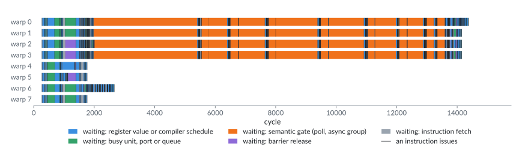
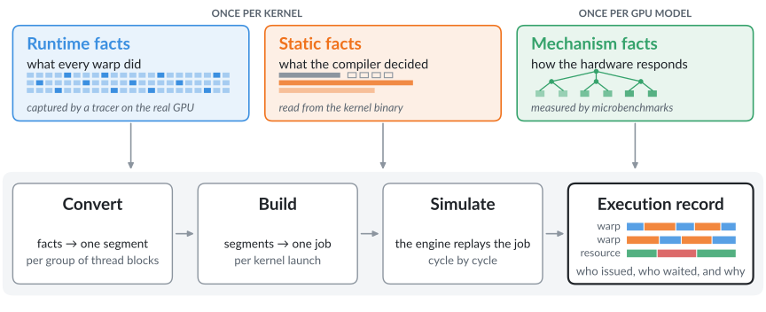
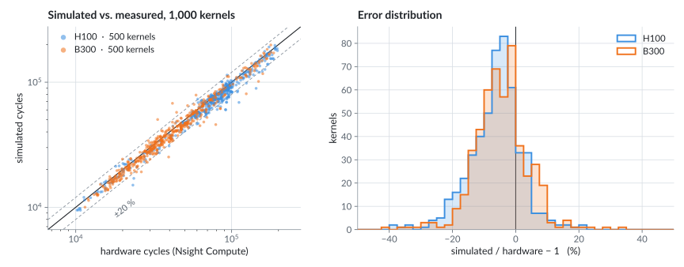

<p align="center">
  <picture>
    <source media="(prefers-color-scheme: dark)" srcset="docs/assets/logo-dark.svg">
    
  </picture>
</p>

<p align="center">
  <b>逐周期看清你的 kernel 在 GPU 上发生了什么。</b>
</p>

<p align="center">
  <a href="LICENSE"></a>
  
  
  
</p>

<p align="center">
  <a href="#工作原理">工作原理</a> ·
  <a href="#快速开始">快速开始</a> ·
  <a href="#文档">文档</a> ·
  <a href="#精度">精度</a> ·
  <a href="README.md">English</a>
</p>

---

CycleScope 是一个逐周期仿真器，重建 kernel 在 NVIDIA GPU 上的一次真实执行。Profiler 告诉你 kernel 跑了多久、warp 停顿了多少次；CycleScope 告诉你**每条指令何时发射、等了多久、在等什么**。

它依据事实而不是拟合参数：kernel 做了什么靠采集，硬件怎么反应靠测量，没有任何参数按工作负载调过。

<p align="center">
  <picture>
    <source media="(prefers-color-scheme: dark)" srcset="docs/assets/record-dark.svg">
    
  </picture>
</p>

<p align="center"><sub>
H100 上一个 DeepGEMM kernel 的一个线程块，由 CycleScope 对随仓库提供的示例 <code>deepgemm_einsum_05</code> 的输出画出。四个 warp 在整次运行的大部分时间里停在语义门上；另外四个 warp 在前 2,700 个周期内就发射完了最后一条指令。
</sub></p>

## 工作原理

为硬件设计而生的仿真器回答的是：机器这样造，*可能*发生什么。Kernel 开发者问的是另一个问题：这个 kernel 在这块 GPU 上*已经*发生了什么。已经发生的执行不需要预测，它可以被采集和测量。

<p align="center">
  <picture>
    <source media="(prefers-color-scheme: dark)" srcset="docs/assets/overview-dark.svg">
    
  </picture>
</p>

CycleScope 用三类事实。

| | 是什么 | 从哪来 |
|---|---|---|
| **运行时事实** | 每个 warp 做了什么：执行的指令、访问的地址、同步操作的操作数 | tracer，在 kernel 于真实 GPU 上运行时采集 |
| **静态事实** | 编译器决定了什么：指令、寄存器依赖、控制字里的调度 | kernel 二进制 |
| **机制事实** | 硬件如何反应：延迟、发射间隔、带宽、容量 | 微基准，每款 GPU 测一次，存进*机制树* |

逐周期引擎把采集到的执行对着机制树重放：决定每条指令何时发射，解出每个 barrier，跟踪每个被建模资源的占用。结果是一份**执行记录**，性能问题由此变成查表，而不是从聚合计数里猜。

更深入的讲解见[设计文档](docs/zh/design/README.md)。

## 快速开始

> [!TIP]
> CycleScope 的环节比较多：tracer、采集工具、转换管线、机制树和它的微基准。建议让编码代理（agent）来操作。把[代理手册](docs/zh/agents/README.md)交给它：手册覆盖新 kernel 与新库的采集，以及运行失败时各阶段的排查。

| | 仿真随仓库提供的示例 | 采集并仿真自己的 kernel |
|---|---|---|
| **GPU** | 不需要 | NVIDIA H100（`sm_90a`）或 B300（`sm_103a`） |
| **需要** | Linux、CMake ≥ 3.20、C++20 编译器、Python ≥ 3.10、OpenSSL 头文件、`zstd` | 同左，另加采集工具（NVBit tracer、Nsight Compute、CUDA 工具链） |

### 1. 仿真随仓库提供的示例

仓库自带十个采集好的 kernel，每架构五个。采集之后的所有步骤都在 CPU 上跑。

```bash
git clone https://github.com/CycleScope-project/CycleScope.git && cd CycleScope
bash examples/run_examples.sh hopper deepgemm_einsum_05
```

脚本首次运行时构建引擎，然后仿真这个 kernel 并打印报告。仿真周期数与 Nsight Compute 在 GPU 上为同一次 launch 测得的周期数并排给出：

| 用例 | 指令数 | 仿真周期 | 硬件周期 | 误差 |
|---|---|---|---|---|
| `deepgemm_einsum_05` | 357,980 | 15,787 | 15,625 | 1.04 % |

`bash examples/run_examples.sh` 跑完全部十个。想要逐指令的记录，安装命令行并加上 `--ledgers`：

```bash
pip install -e .
cyclescope run --suite hopper/full_gpu --case deepgemm_einsum_05 \
    --captures examples/captures/hopper --out out/example --ledgers
cyclescope report out/example
```

这会在结果旁边写出发射日志与等待账本。[读结果](docs/zh/results.md)给出了几行 Python 的读取方法；本页顶部的图就是用这份发射日志画的。

全部 1,000 个套件 kernel 的发射日志与等待账本单独发布在 [CycleScope-records](https://github.com/CycleScope-project/CycleScope-records)。

### 2. 采集并仿真自己的 kernel

采集在 GPU 上进行。先把采集工具搭好，只需一次：

```bash
export CYCLESCOPE_ARTIFACT_ROOT=/path/to/tools
python3 scripts/provision/provision_tools.py plan          # 列出要搭建的内容
python3 scripts/provision/provision_tools.py fetch --all
python3 scripts/provision/provision_tools.py build <name>  # 每个 build 项，在它的工具链环境里
python3 scripts/provision/provision_tools.py verify --all
```

其中只有 Nsight Compute 需要手动下载。之后去掉 `--captures`：一条命令完成 trace、用 Nsight Compute 取硬件参照、转换和仿真。

```bash
cyclescope run --suite hopper/full_gpu --case deepgemm_bf16_dense_02 --out out/captured
cyclescope report out/captured
```

自己的 kernel 是套件表里的一行，例如 `suites/hopper/local/cases.tsv`：运行你的应用的命令行，加上一个选中 kernel launch 的模式。

```bash
cyclescope capture --suite hopper/local --case my_kernel --out out/mine --dry-run   # 检查这一行
cyclescope run     --suite hopper/local --case my_kernel --out out/mine
```

细节见[采集工具与设置](docs/zh/capture-tools.md)和[采集新 kernel](docs/zh/agents/new-kernel.md) 的逐步指南。在 Blackwell 上，新的库还需要一个小适配器（[采集新库](docs/zh/agents/new-library.md)）。

## 文档

| 我想… | 读 |
|---|---|
| 构建 CycleScope 并跑第一个 kernel | [入门](docs/zh/getting-started.md) |
| 知道每个阶段做什么、写出什么 | [管线](docs/zh/pipeline.md) |
| 读报告、发射日志与等待账本 | [读结果](docs/zh/results.md) |
| 在自己的 GPU 上采集 kernel | [采集工具与设置](docs/zh/capture-tools.md) · [参考环境](docs/zh/environment.md) |
| 理解设计 | [设计文档](docs/zh/design/README.md) |
| 看硬件行为怎么测量 | [微基准](docs/zh/microbench.md) |
| 排查失败的运行，或接入新的库 | [代理手册](docs/zh/agents/README.md) |

完整索引见 [docs/zh](docs/zh/README.md)；英文版在 [docs/en](docs/en/README.md)。

<details>
<summary><b>仓库布局</b></summary>

| 路径 | 内容 |
|---|---|
| `cpp/` | 引擎（`core/`）、转换工具（`capture/`、`convert/`）、架构模块（`arch/<arch>/`）、C++ 测试 |
| `python/cyclescope/` | `cyclescope` 命令：采集驱动、转换器、作业构建器、树工具、run 与 report |
| `tools/tracer/` | NVBit tracer |
| `tools/microbench/` | 微基准及其协议 |
| `configs/` | 机制树、schema 登记簿、硬件表、采集工具登记、参考环境 |
| `suites/` | 评估套件：每架构 500 个 kernel，含参照与完整结果 |
| `examples/` | 十个示例 capture，无 GPU 也能跑 |
| `scripts/` | 辅助脚本：运行对比、采集工具搭建 |
| `tests/` | Python 测试 |

</details>

## 精度

CycleScope 在 1,000 个生产 kernel 上评估，每架构 500 个，取自 cuBLAS、CUTLASS、DeepGEMM、FlashAttention、FlashInfer、FlashMLA 与 Triton。参照是 Nsight Compute 在 GPU 上为同一次 launch 测得的周期数。

<p align="center">
  <picture>
    <source media="(prefers-color-scheme: dark)" srcset="docs/assets/accuracy-dark.svg">
    
  </picture>
</p>

| GPU | kernel 数 | 平均误差（MAPE） | 第 90 百分位误差 | 中位 仿真 / 硬件 |
|---|---|---|---|---|
| NVIDIA H100（Hopper） | 500 | 7.93 % | 17.2 % | 0.947 |
| NVIDIA B300（Blackwell） | 500 | 7.64 % | 14.8 % | 0.952 |

这张表背后的逐 kernel 结果在 `suites/<arch>/full_gpu/results/`，每个 kernel 的逐指令记录在 [CycleScope-records](https://github.com/CycleScope-project/CycleScope-records)。[精度与验证](docs/zh/release-validation.md)说明了参照怎么取、还检查了什么、没检查什么。

---

<p align="center"><sub>
以 <a href="LICENSE">MIT 许可证</a>发布 ·
<a href="THIRD_PARTY_NOTICES.md">第三方声明</a>
</sub></p>
